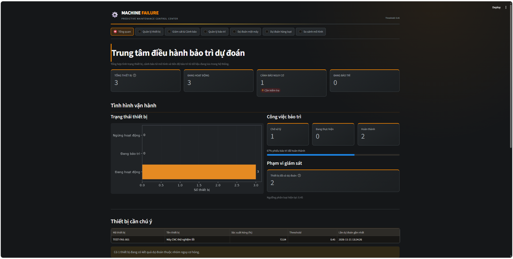
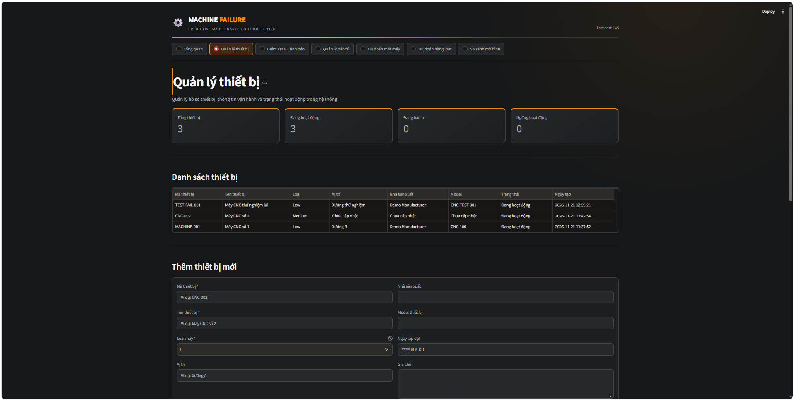
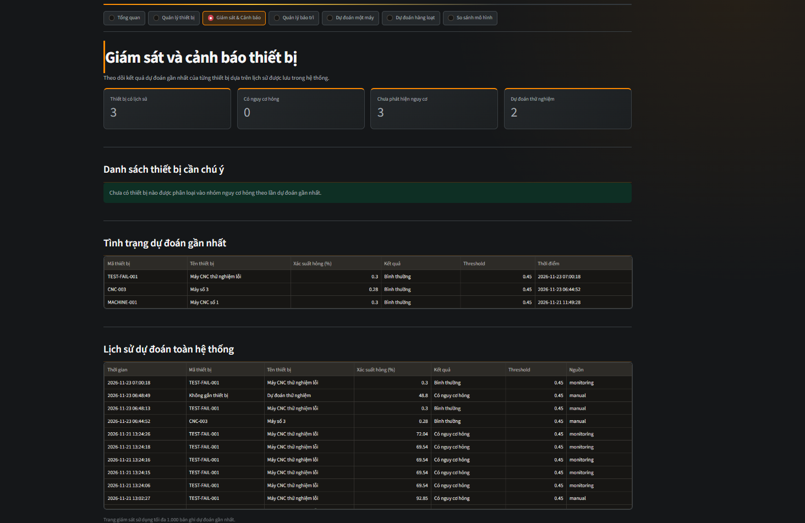
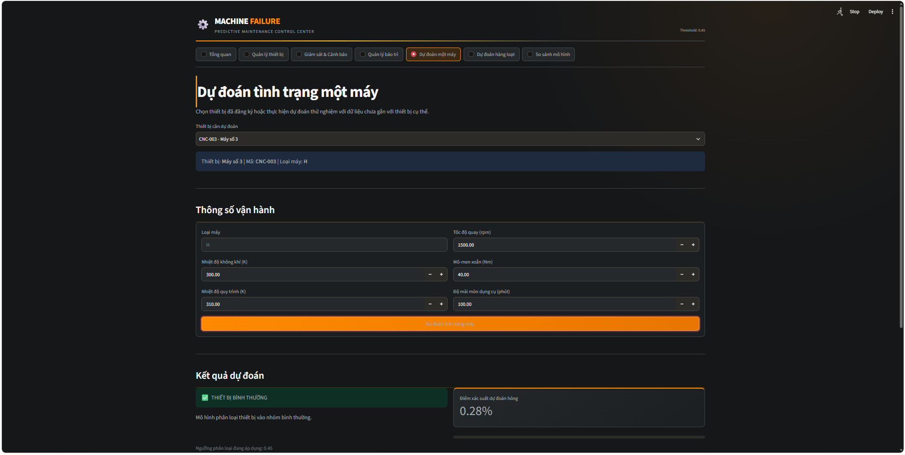
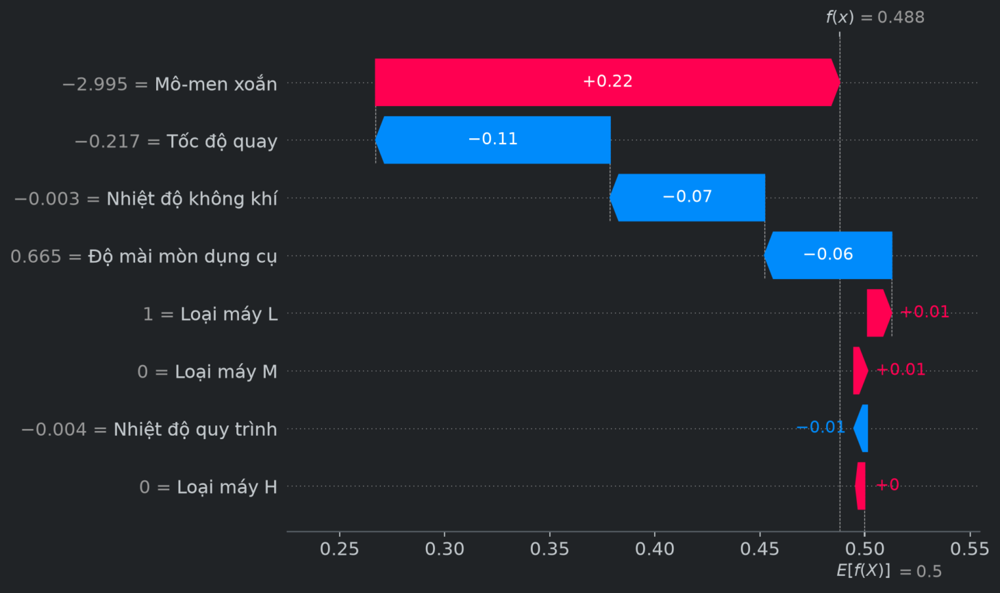
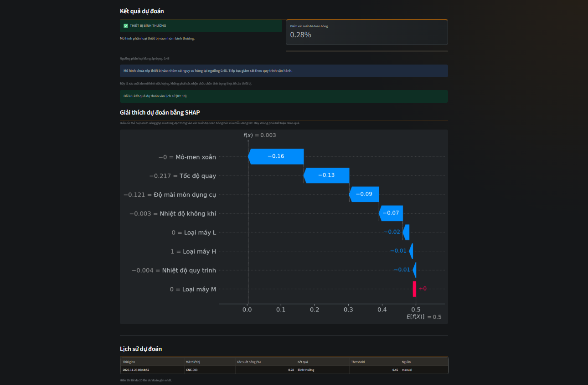
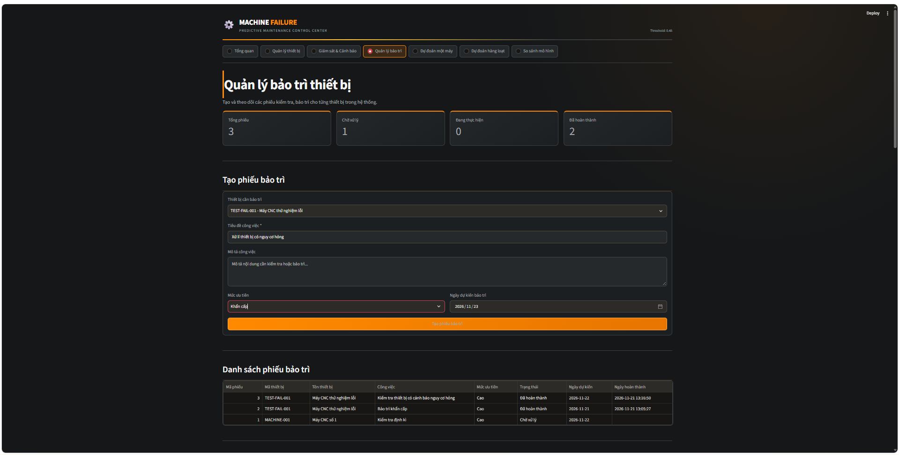

# Machine Failure Prediction – Hệ thống dự đoán và quản lý bảo trì máy móc

Ứng dụng hỗ trợ đánh giá nguy cơ hỏng hóc máy móc công nghiệp bằng Machine Learning, đồng thời cung cấp các chức năng quản lý thiết bị, theo dõi lịch sử dự đoán, cảnh báo nguy cơ và quản lý phiếu bảo trì.

Dự án được xây dựng trong khuôn khổ học phần **Học máy và ứng dụng**. Mục tiêu là minh họa quy trình từ xử lý dữ liệu, huấn luyện và đánh giá mô hình đến tích hợp mô hình vào một ứng dụng có thể sử dụng.

> **Phạm vi sử dụng:** Đây là sản phẩm học tập/nghiên cứu. Ứng dụng hiện chưa kết nối cảm biến, PLC hoặc hệ thống IoT và không nhận dữ liệu vận hành thời gian thực. Kết quả dự đoán không thay thế việc kiểm tra kỹ thuật, quy trình an toàn hoặc quyết định của nhân viên bảo trì.

---

## 1. Tổng quan dự án

Dự án sử dụng **AI4I 2020 Predictive Maintenance Dataset** để xây dựng và so sánh các mô hình phân loại tình trạng hỏng hóc. Mô hình Random Forest được lựa chọn để tích hợp vào ứng dụng Streamlit. Ngưỡng phân loại hiện tại là **0,45**, được lựa chọn bằng F1-score trên xác suất Out-of-Fold (OOF) của tập huấn luyện.

Bên cạnh chức năng dự đoán, ứng dụng có cơ sở dữ liệu SQLite để lưu thông tin thiết bị, lịch sử dự đoán và phiếu bảo trì. Nhờ đó, người dùng có thể theo dõi kết quả dự đoán gắn với từng thiết bị thay vì chỉ phân tích một tập dữ liệu rời rạc.

## 2. Chức năng hệ thống

### 2.1. Tổng quan (Dashboard)

- Hiển thị thông tin tổng quan về dữ liệu và hoạt động của hệ thống.
- Theo dõi số lượng thiết bị đã đăng ký, lịch sử dự đoán và tình trạng cảnh báo.
- Cung cấp điểm truy cập đến các chức năng chính.

### 2.2. Quản lý thiết bị

- Thêm thiết bị với mã thiết bị nội bộ riêng.
- Lưu tên thiết bị, loại máy (L/M/H), vị trí, nhà sản xuất, model và ghi chú.
- Xem và cập nhật thông tin thiết bị.
- Theo dõi trạng thái thiết bị trong danh mục quản lý.

Mã thiết bị nội bộ được dùng để liên kết lịch sử dự đoán và phiếu bảo trì. Các mã định danh trong dataset như UDI hoặc Product ID không được sử dụng làm đặc trưng đầu vào của mô hình.

### 2.3. Giám sát và cảnh báo

- Hiển thị kết quả dự đoán gần nhất của từng thiết bị.
- Theo dõi xác suất dự đoán, nhãn phân loại, ngưỡng đang áp dụng và thời điểm dự đoán.
- Liệt kê các thiết bị có kết quả phân loại thuộc nhóm nguy cơ hỏng.
- Xem lịch sử dự đoán được lưu trong SQLite.

Cảnh báo phản ánh kết quả phân loại của mô hình tại thời điểm nhận dữ liệu đầu vào. Người dùng cần xác minh tình trạng thiết bị bằng quy trình kiểm tra thực tế.

### 2.4. Dự đoán tình trạng một máy

- Chọn thiết bị đã đăng ký hoặc sử dụng chế độ dự đoán thử nghiệm.
- Nhập sáu thông số đầu vào: loại máy, nhiệt độ không khí, nhiệt độ quy trình, tốc độ quay, mô-men xoắn và độ mài mòn dụng cụ.
- Nhận xác suất dự đoán và nhãn phân loại theo threshold hiện tại.
- Xem phần giải thích SHAP cho mẫu đang xét.
- Lưu kết quả vào lịch sử khi dự đoán được gắn với thiết bị.

### 2.5. Dự đoán hàng loạt

- Tải lên tệp CSV chứa nhiều mẫu cần dự đoán.
- Kiểm tra cột bắt buộc, dữ liệu thiếu, kiểu dữ liệu, loại máy và miền giá trị đầu vào.
- Dự đoán cho các dòng dữ liệu hợp lệ.
- Tải kết quả dự đoán dưới dạng CSV.

### 2.6. Quản lý bảo trì

- Tạo phiếu bảo trì gắn với thiết bị đã đăng ký.
- Ghi tiêu đề công việc, mô tả, mức ưu tiên và ngày dự kiến.
- Theo dõi trạng thái phiếu: chờ xử lý, đang thực hiện hoặc đã hoàn thành.
- Cập nhật trạng thái và ghi nhận thời điểm hoàn thành.

Việc hoàn thành phiếu bảo trì không tự động thay đổi các thông số vận hành đã lưu của thiết bị. Nếu cần đánh giá lại tình trạng sau bảo trì, người dùng phải nhập thông số mới và thực hiện dự đoán mới.

### 2.7. So sánh mô hình

- Xem kết quả so sánh các thuật toán đã thực nghiệm.
- Theo dõi các chỉ số Accuracy, Precision, Recall, F1-score và ROC-AUC.
- Xem Confusion Matrix và các kết quả liên quan đến điều chỉnh threshold.
- Tham khảo Feature Importance và các biểu đồ phân tích được lưu trong dự án.

---

## 3. Công nghệ sử dụng

| Thành phần | Công nghệ |
|---|---|
| Ngôn ngữ | Python |
| Xử lý dữ liệu | Pandas, NumPy |
| Học máy | Scikit-learn, imbalanced-learn |
| Giao diện ứng dụng | Streamlit |
| Giải thích mô hình | SHAP |
| Lưu và nạp mô hình | Joblib |
| Cơ sở dữ liệu | SQLite |
| Trực quan hóa | Matplotlib, Seaborn |

**Lưu ý tương thích:** Các mô hình `.pkl` trong repository được tuần tự hóa bằng **scikit-learn 1.9.1**. `requirements.txt` đã ghim phiên bản này. Nên cài đặt trong môi trường ảo và sử dụng đúng phiên bản để hạn chế cảnh báo hoặc lỗi khi nạp mô hình.

## 4. Dữ liệu và mô hình học máy

### 4.1. Dataset

- **Tên:** AI4I 2020 Predictive Maintenance Dataset.
- **Nguồn:** [UCI Machine Learning Repository – AI4I 2020](https://archive.ics.uci.edu/dataset/601/ai4i).
- **Quy mô:** 10.000 bản ghi.
- **Đặc điểm:** Dữ liệu có tỷ lệ mẫu hỏng thấp hơn đáng kể so với mẫu bình thường.

Sáu đặc trưng được sử dụng làm đầu vào:

| Đặc trưng | Ý nghĩa |
|---|---|
| `Type` | Loại máy/sản phẩm (L, M, H) |
| `Air temperature [K]` | Nhiệt độ không khí |
| `Process temperature [K]` | Nhiệt độ quy trình |
| `Rotational speed [rpm]` | Tốc độ quay |
| `Torque [Nm]` | Mô-men xoắn |
| `Tool wear [min]` | Độ mài mòn dụng cụ |

Các cột định danh và các cột mô tả trực tiếp dạng lỗi được loại khỏi đầu vào nhằm hạn chế rò rỉ thông tin mục tiêu.

### 4.2. Các thuật toán đã thử nghiệm

1. Logistic Regression
2. K-Nearest Neighbors (KNN)
3. Decision Tree
4. Random Forest
5. Support Vector Machine (SVM)

Các mô hình được so sánh bằng Stratified 5-Fold Cross-validation trên tập huấn luyện. Dự án tiếp tục khảo sát `class_weight`, Random Oversampling và điều chỉnh ngưỡng phân loại.

### 4.3. Mô hình sử dụng trong ứng dụng

Ứng dụng tải mô hình:

```text
results/threshold_tuned_random_forest.pkl
```

Ngưỡng phân loại được đọc từ:

```text
results/threshold_experiment_metadata.json
```

Threshold hiện tại: **0,45**.

Ngưỡng được lựa chọn bằng cách tối đa hóa F1-score trên xác suất OOF của tập huấn luyện. Tập kiểm thử được giữ riêng để đánh giá cuối cùng.

| Chỉ số trên tập kiểm thử | Threshold 0,50 | Threshold 0,45 |
|---|---:|---:|
| Accuracy | 0,9730 | 0,9720 |
| Precision | 0,5897 | 0,5667 |
| Recall | 0,6765 | 0,7500 |
| F1-score | 0,6301 | 0,6456 |

Việc giảm threshold giúp tăng Recall và F1-score trong lần thực nghiệm này, đồng thời làm giảm Precision. Đây là sự đánh đổi giữa khả năng phát hiện thêm trường hợp hỏng và nguy cơ tăng cảnh báo nhầm.

**Lưu ý:** Xác suất đầu ra là ước lượng của mô hình, không được xác nhận là xác suất đã hiệu chuẩn. SHAP mô tả đóng góp của đặc trưng vào đầu ra mô hình, không chứng minh quan hệ nhân quả hoặc xác định chắc chắn nguyên nhân hỏng hóc vật lý.

---

## 5. Cơ sở dữ liệu SQLite

Ứng dụng sử dụng SQLite để lưu dữ liệu nghiệp vụ cục bộ. Cơ sở dữ liệu chính nằm tại:

```text
database/machine_management.db
```

Các bảng chính:

| Bảng | Chức năng |
|---|---|
| `machines` | Lưu danh mục và thông tin thiết bị |
| `prediction_history` | Lưu thông số đầu vào, xác suất, nhãn dự đoán, threshold, nguồn và thời điểm |
| `maintenance_records` | Lưu phiếu bảo trì, mức ưu tiên, trạng thái và thời gian hoàn thành |

`prediction_history` liên kết với thiết bị thông qua `machine_id`. Các dự đoán thử nghiệm không gắn với thiết bị có thể có `machine_id` rỗng.

Cơ sở dữ liệu được khởi tạo thông qua module `src/database.py` khi ứng dụng thực hiện quy trình khởi tạo. Nếu cần kiểm tra hoặc sao lưu dữ liệu, hãy đóng ứng dụng trước khi sao chép tệp SQLite.

---

## 6. Cấu trúc dự án

```text
MachineFailurePrediction/
├── data/
│   └── ai4i2020.csv
├── database/
│   └── machine_management.db
├── figures/
│   ├── giaoDien1.png
│   ├── quanLy1.png
│   ├── giamSat.png
│   ├── duDoan1.png
│   ├── duDoanLoiSHAP.png
│   ├── duDoan2.png
│   ├── baoTri1.png
│   └── ...
├── models/
│   ├── best_model.pkl
│   └── metadata.json
├── results/
│   ├── threshold_tuned_random_forest.pkl
│   ├── threshold_experiment_metadata.json
│   ├── threshold_test_comparison.csv
│   ├── threshold_oof_comparison.csv
│   ├── threshold_confusion_matrices.csv
│   ├── model_comparison.csv
│   ├── imbalance_experiment.csv
│   └── ...
├── src/
│   ├── __init__.py
│   ├── database.py
│   ├── inference.py
│   ├── train.py
│   ├── imbalance_experiment.py
│   └── threshold_experiment.py
├── tests/
│   └── test_inference.py
├── app.py
├── requirements.txt
└── README.md
```

---

## 7. Cài đặt trên Windows

### 7.1. Yêu cầu

- Windows 10/11.
- Python 3.10 trở lên.
- Git (nếu tải dự án bằng Git).
- Scikit-learn 1.9.1 theo phiên bản đã dùng để lưu mô hình.

### 7.2. Tải mã nguồn

Thay `<GITHUB_REPOSITORY_URL>` bằng URL repository thực tế:

```powershell
git clone <GITHUB_REPOSITORY_URL>
cd MachineFailurePrediction
```

Nếu đã tải ZIP, giải nén dự án và mở PowerShell tại thư mục gốc `MachineFailurePrediction`.

### 7.3. Tạo môi trường ảo và cài thư viện

```powershell
python -m venv .venv
.venv\Scripts\activate
python -m pip install --upgrade pip
pip install -r requirements.txt
```

Nếu PowerShell chặn việc kích hoạt môi trường ảo, có thể chạy:

```powershell
Set-ExecutionPolicy -Scope Process -ExecutionPolicy Bypass
.venv\Scripts\activate
```

---

## 8. Khởi chạy ứng dụng

Từ thư mục gốc dự án, sau khi đã kích hoạt môi trường ảo:

```powershell
python -m streamlit run app.py
```

Mở địa chỉ được Streamlit hiển thị trên terminal. Mặc định thường là:

```text
http://localhost:8501
```

Ảnh minh họa giao diện:

### Giao diện tổng quan



### Quản lý thiết bị



### Giám sát và cảnh báo



### Dự đoán một máy và giải thích SHAP





### Dự đoán hàng loạt



### Quản lý bảo trì



---

## 9. Chạy kiểm thử

Từ thư mục gốc dự án:

```powershell
python -m unittest discover -s tests -v
```

Các kiểm thử hiện có tập trung vào module suy luận, gồm dữ liệu hợp lệ, thiếu cột, loại máy không hợp lệ, giá trị ngoài miền và việc áp dụng threshold. Kiểm thử không thay thế việc kiểm tra thủ công toàn bộ luồng giao diện và nghiệp vụ.

## 10. Chạy lại thực nghiệm

Các script thực nghiệm nằm trong thư mục `src/`:

```powershell
python src/train.py
python src/imbalance_experiment.py
python src/threshold_experiment.py
```

Các script có thể tạo hoặc cập nhật mô hình và kết quả trong `models/` hoặc `results/`. **Hãy sao lưu các tệp kết quả và mô hình hiện tại trước khi chạy lại**, đặc biệt nếu đang chuẩn bị phiên bản dùng để nộp.

## 11. Giới hạn và hướng phát triển

### Giới hạn hiện tại

- Dataset AI4I 2020 là dữ liệu tổng hợp, chưa đại diện cho mọi điều kiện vận hành của nhà máy thực tế.
- Ứng dụng chưa kết nối cảm biến, PLC hoặc IoT; dữ liệu được nhập thủ công hoặc tải từ CSV.
- Mô hình phân loại nguy cơ tại thời điểm nhận đầu vào, không dự báo thời gian còn lại trước khi hỏng (Remaining Useful Life).
- Xác suất mô hình chưa được hiệu chuẩn để diễn giải như xác suất hỏng thực tế.
- SHAP giải thích hành vi mô hình, không xác định quan hệ nhân quả.
- Kết quả cần được xác minh bởi quy trình kiểm tra kỹ thuật trước khi đưa ra quyết định bảo trì.

### Hướng phát triển

- Thu thập dữ liệu vận hành thực tế có dấu thời gian và lịch sử bảo trì.
- Đánh giá mô hình trên nhiều dòng máy và điều kiện vận hành.
- Nghiên cứu phân loại từng dạng lỗi hoặc ước lượng Remaining Useful Life.
- Hiệu chuẩn xác suất và lựa chọn threshold theo chi phí cảnh báo nhầm/bỏ sót.
- Bổ sung kiểm thử tự động cho các luồng nghiệp vụ, phân quyền người dùng và sao lưu dữ liệu.
- Nghiên cứu tích hợp IoT/PLC khi có hạ tầng dữ liệu và yêu cầu an toàn phù hợp.

## 12. Tài liệu tham khảo

1. UCI Machine Learning Repository, [AI4I 2020 Predictive Maintenance Dataset](https://archive.ics.uci.edu/dataset/601/ai4i), 2020.
2. L. Breiman, [“Random Forests”](https://doi.org/10.1023/A:1010933404324), *Machine Learning*, vol. 45, no. 1, pp. 5–32, 2001.
3. N. V. Chawla, K. W. Bowyer, L. O. Hall, and W. P. Kegelmeyer, [“SMOTE: Synthetic Minority Over-sampling Technique”](https://doi.org/10.1613/jair.953), *Journal of Artificial Intelligence Research*, vol. 16, pp. 321–357, 2002.
4. S. Matzka, [“Explainable Artificial Intelligence for Predictive Maintenance Applications”](https://doi.org/10.1109/AI4I49448.2020.00023), 2020.

---

**Học phần:** Học máy và ứng dụng  
**Đề tài:** Dự đoán nguy cơ hỏng hóc máy móc bằng các phương pháp học máy
